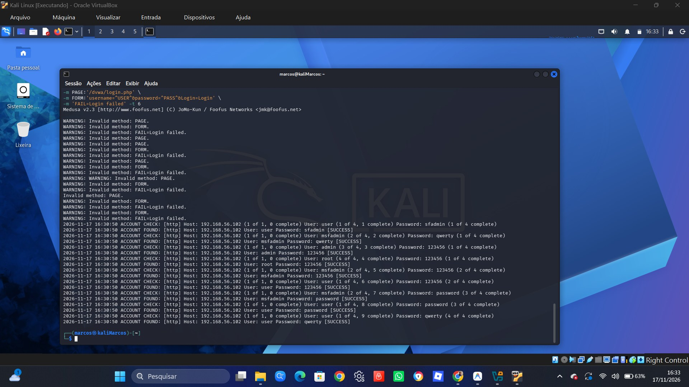

# 04 — Reflexão: conceitos, ética e lições

> ⚠️ **Este texto é um rascunho para você reescrever com as suas palavras.**
> O objetivo da DIO é que a reflexão seja **sua**. Use esta estrutura como
> esqueleto, mas troque os exemplos pelos que você viveu no seu laboratório.

---

## 1. O que é, afinal, um ataque de força bruta

Força bruta é a tentativa sistemática de descobrir uma credencial testando
possibilidades. O termo cobre técnicas bem diferentes:

| Técnica | Estratégia | Exemplo no laboratório | Espaço de busca |
| --- | --- | --- | --- |
| **Força bruta pura** | Todas as combinações possíveis | `aaaa`, `aaab`, `aaac`... | Gigantesco (inviável além de ~8 caracteres) |
| **Dicionário** | Lista de senhas prováveis | `medusa -P wordlists/senhas.txt` | Pequeno e altamente eficaz |
| **Password spraying** | 1 senha fraca × muitos usuários | `scripts/smb_spray.sh` | Depende da política de lockout |
| **Credential stuffing** | Usuário:senha vazados de outro serviço | (não abordado) | Depende do reuso de senha |

A distinção mais importante do desafio é a **terceira linha**. O spraying não é
"força bruta mais lenta": é uma adaptação que **contorna especificamente** o
lockout — a defesa mais comum. Isso mostra algo essencial: **defesas isoladas
são contornadas; defesas em camadas não.**

---

## 2. O que eu aprendi sobre o Medusa

Executando os três cenários deste laboratório, quatro coisas ficaram claras.

**1. O Medusa é modular — e isso é uma faca de dois gumes.**
A mesma ferramenta ataca FTP (`-M ftp`), formulário HTML (`-M web-form`) e SMB
(`-M smbnt`). Você aprende **um** modelo mental e aplica em vários protocolos.
Mas a sintaxe de cada módulo é rígida, e escolher o módulo errado não gera erro:
gera **resultado errado com aparência de sucesso**.

**2. O `-c` (espera em µs para validar o socket) foi o detalhe mais inesperado.**
Sem `-c 1000`, o ataque ao vsftpd "falha" — não porque a senha está errada, mas
porque um mecanismo anti-bruteforce do serviço **fecha a conexão** após algumas
tentativas. O Medusa continua tentando enviar credenciais em um socket morto e
reporta erro de conexão para tudo.

**3. O `-e ns` resolve mais casos do que qualquer wordlist.**
No cenário FTP, `-e ns` encontrou `user:user` e `msfadmin:msfadmin` em 40
segundos. A senha igual ao nome de usuário é um padrão tão comum que vale testá-lo
**antes** de qualquer dicionário. Meu primeiro teste, sem essa flag, terminou sem
nenhum acerto — a senha certa simplesmente não estava na minha lista.

**4. No `web-form`, a fragilidade é estrutural.**
`FORM-DATA` na ordem errada, `DENY-SIGNAL` com o texto errado, ou um token
anti-CSRF: qualquer um dos três faz o ataque falhar silenciosamente — ou, pior,
reportar tudo como sucesso.

---

### O erro que me ensinou o que é um falso positivo



Na primeira tentativa no DVWA, inventei uma sintaxe que parecia razoável:

```bash
# ERRADO — esses parâmetros não existem no Medusa
-m PAGE:/dvwa/login.php \
-m FORM:"username=USER&password=PASS&Login=Login" \
-m FAIL=Login failed
```

O Medusa respondeu exatamente o que deveria:

```text
WARNING: Invalid method: PAGE.
WARNING: Invalid method: FORM.
WARNING: Invalid method: FAIL=Login failed.
```

E então — como não reconheceu nenhum parâmetro — caiu no módulo padrão `http`
(HTTP Basic Auth), que trata **qualquer resposta diferente de `401`** como login
válido. O DVWA não usa Basic Auth, então responde `200` para tudo.

O resultado:

```text
ACCOUNT FOUND: [http] ... User: user     Password: sfadmin  [SUCCESS]
ACCOUNT FOUND: [http] ... User: msfadmin Password: qwerty   [SUCCESS]
ACCOUNT FOUND: [http] ... User: admin    Password: 123456   [SUCCESS]
ACCOUNT FOUND: [http] ... User: root     Password: 123456   [SUCCESS]
```

**Todas** as senhas "funcionaram". Se `admin:123456` e `root:qwerty` fossem
válidas ao mesmo tempo, não haveria ataque nenhum a fazer — o sinal de alerta
estava no absurdo do resultado.

O que revelou o erro foi a **validação manual**: abri o DVWA no navegador e o
login real era `admin` / `password`, não `admin` / `123456`. A divergência entre
a "descoberta" e a realidade expôs o falso positivo.

**Três lições que levo deste episódio:**

1. **Sintaxe correta:**
   `-m FORM-DATA:"post?campo1=&campo2=&botao=valor"` mais
   `-m DENY-SIGNAL:"<texto da falha>"`. É `DENY-SIGNAL`, não `DENIAL-SIGNAL`.
2. **Módulo correto:** formulário HTML é `web-form`; `http` é para Basic Auth.
   Escolher errado não gera erro — gera **falso positivo**.
3. **Nunca confie num resultado sem validar o acesso na mão.** Um print onde
   *todas* as senhas funcionam é o sintoma clássico de módulo errado ou
   `DENY-SIGNAL` mal configurado. Validar custa 30 segundos; publicar um
   resultado falso custa a credibilidade inteira do trabalho.

> 💡 **Por que guardei o print do erro no repositório:** porque ele documenta o
> raciocínio. Mostrar apenas os acertos não prova competência — qualquer um cola
> um comando. Mostrar como identifiquei e corrigi um falso positivo prova que eu
> **sei o que estou olhando**.

---

## 3. O que eu aprendi sobre defesa

*(reescreva com as suas observações)*

Três conclusões que mudaram a minha forma de ver autenticação:

**1. A senha não é o componente mais frágil — o limite de tentativas é.**
Um sistema com senhas medianas, mas com `5 tentativas/minuto` e MFA, resiste a
todo este laboratório. Um sistema com senhas "complexas", mas sem limite de
tentativas, cai para um dicionário.

**2. Lockout permanente é uma faca de dois gumes.**
Ele bloqueia o atacante **e** o usuário legítimo. Pior: permite que um atacante
cause DoS de contas de propósito. A resposta correta é **lockout progressivo +
MFA + detecção**, não "bloquear para sempre".

**3. Detecção por padrão, não por evento.**
Um `4625` isolado é rotina (todo mundo digita a senha errada). Cinquenta `4625`
em trinta segundos, para **contas diferentes**, do **mesmo IP**, é ataque. A
diferença entre um SOC eficaz e um ineficaz está na correlação.

---

## 4. Ética e escopo — a parte que não é opcional

### 4.1 A linha entre estudo e crime

```text
Laboratório isolado, VMs próprias          →  estudo legítimo
Sistema do cliente, com contrato assinado  →  pentest legítimo
Bug bounty dentro do escopo publicado      →  pesquisa legítima
"Vou só testar a senha do vizinho"          →  CRIME
"É a rede da empresa, eu trabalho lá"       →  CRIME (sem autorização escrita)
```

No Brasil:

- **Lei 12.737/2012** (Carolina Dieckmann): invasão de dispositivo informático,
  pena de detenção + multa, **agravada** se houver obtenção de dados;
- **Lei 12.965/2014** (Marco Civil): dever de segurança e responsabilidade;
- **LGPD**: vazamento de dados pessoais gera sanções administrativas e
  responsabilidade civil.

Autorização **verbal** não serve. Precisa ser **escrita**, com escopo definido:
quais IPs, quais horários, quais técnicas permitidas, o que fazer se um dado
sensível for encontrado. Todo profissional assina um **contrato de pentest** com
uma cláusula de escopo — e respeitar esse escopo é parte do trabalho.

### 4.2 A autorização é do proprietário, não sua

"Tenho acesso ao sistema" ≠ "posso testar o sistema". Um funcionário com login
válido que executa brute force contra o próprio domínio, sem autorização, comete
uma violação — mesmo sem intenção maliciosa. Foi assim que profissionais já
perderam o emprego.

### 4.3 Responsabilidade sobre os dados

Se o laboratório for feito em uma cópia de dados reais (o que **não** é o caso
aqui), as credenciais descobertas são dados sensíveis e devem ser:

```text
✅ Armazenadas de forma segura ou destruídas após o relatório
✅ Nunca publicadas em repositório, chat ou print de tela
✅ Nunca reutilizadas em outro sistema
```

O `.gitignore` deste repositório exclui `logs/` exatamente por isso.

---

## 5. O que eu faria diferente no laboratório

*(espaço para a sua crítica honesta — este é o parágrafo que a DIO mais valoriza)*

Sugestões de tópicos:

- O que deu errado na primeira tentativa de cada cenário?
- Qual configuração consumiu mais tempo e por quê?
- O que eu faria em uma segunda rodada (ex.: aplicar as mitigações e repetir o
  ataque, medindo a diferença)?
- Que ferramenta eu testaria em seguida (Hydra, Ncrack, Patator) e por quê?
- Como eu documentaria isso para um cliente real (relatório executivo vs.
  relatório técnico)?

---

## 6. Conclusão

Um ataque de força bruta bem-sucedido não revela "um sistema inseguro" de forma
genérica — ele aponta **exatamente** onde a política de autenticação falhou:
senha padrão não trocada, ausência de limite de tentativas, ausência de MFA,
serviço exposto sem necessidade.

Esse é o valor real do exercício: ao executar o ataque **eu** consigo ver o que
o defensor precisa ver. E, na prática, as mitigações mais eficazes são as mais
baratas: **limitar tentativas, exigir MFA e monitorar padrões**. Nenhuma delas
depende de tecnologia de ponta — dependem de **saber que o risco existe**.

O conhecimento ofensivo, usado com autorização e ética, é o que permite construir
defesas que realmente funcionam.

---

## 7. Checklist de reflexão (para incluir no relatório)

```text
[ ] Expliquei a diferença entre brute force, dicionário, spraying e stuffing
[ ] Descrevi a mecânica do Medusa (módulos, -t, -c, FORM-DATA, DENY-SIGNAL)
[ ] Documentei os erros que cometi e como resolvi
[ ] Proposei mitigações específicas por serviço (FTP, web, SMB)
[ ] Expliquei por que MFA + rate limit são as defesas mais eficazes
[ ] Discuti a ética: escopo, autorização escrita e responsabilidade sobre dados
[ ] Relacionei com legislação aplicável (12.737, Marco Civil, LGPD)
[ ] Escrevi com as MINHAS palavras, não copiei este arquivo
```
